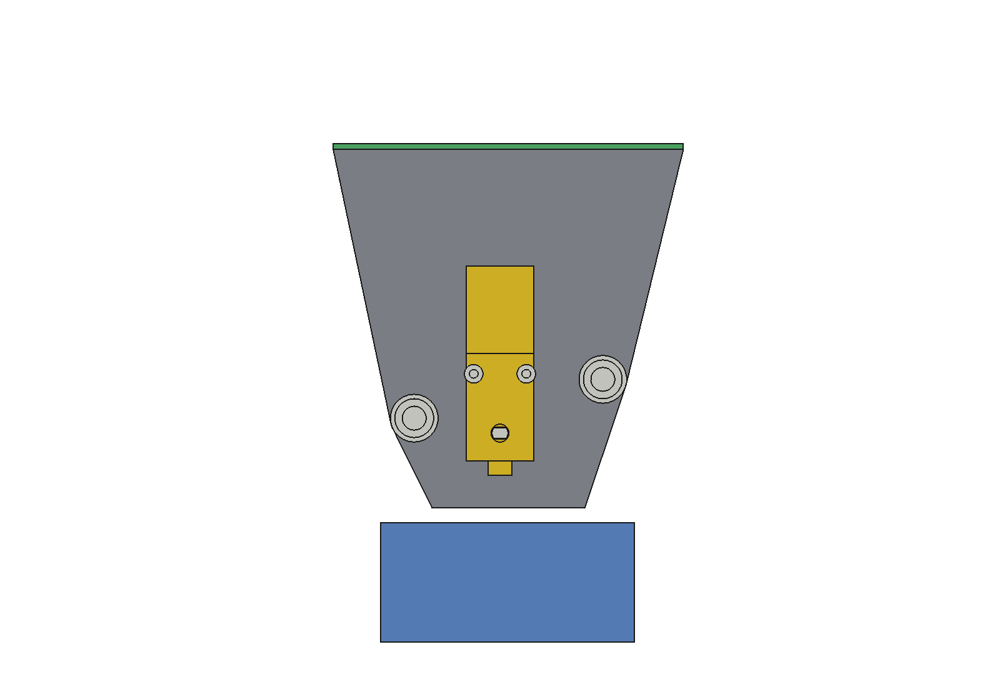
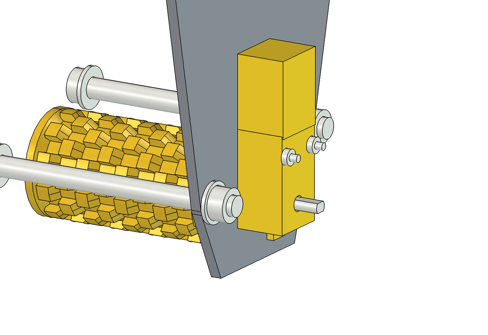
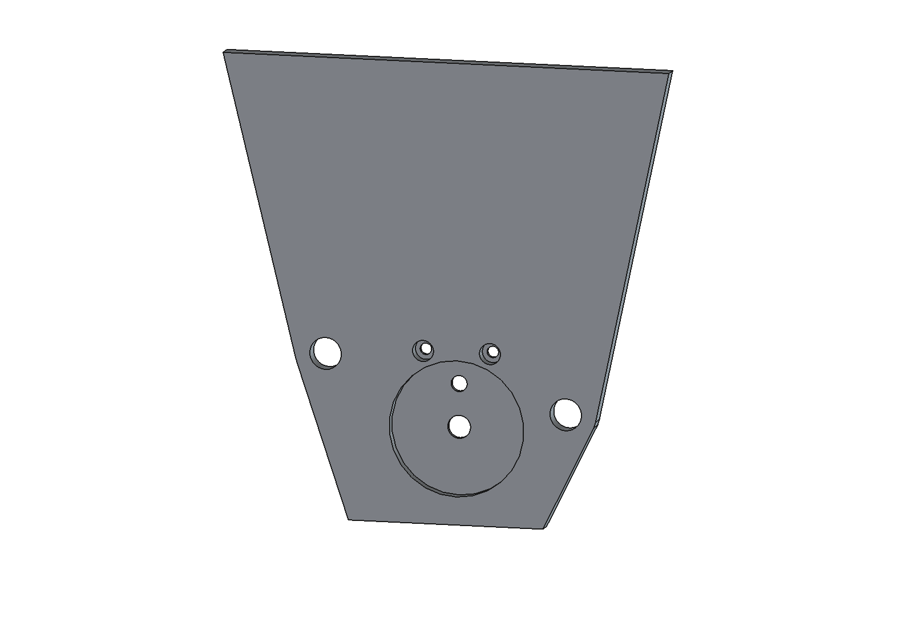
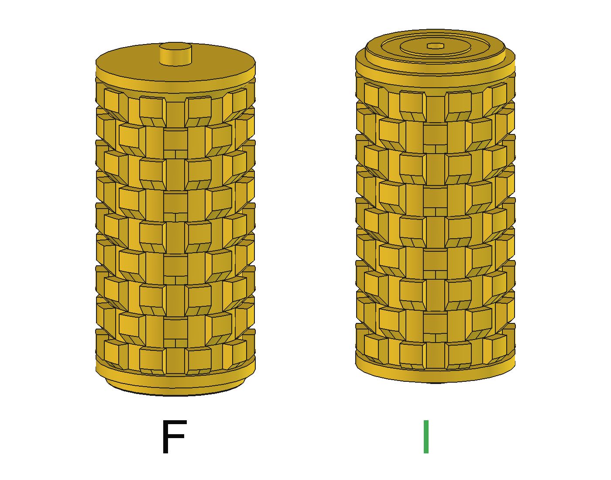
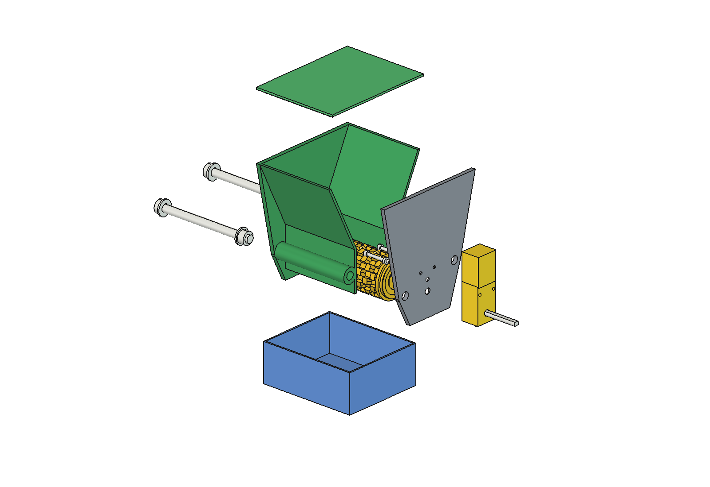

# Mini drop seeder with a TT gear motor (80 mm test version)

A small, temporary test version of the mini hopper of [../stepper_motor/](../stepper_motor/README.md): **80 mm wide, 120 mm high**, driven by a
yellow **TT gear motor** (1:48, double-flat shaft) instead of the NEMA 17. It is held together and mounted with
**two M8 × 100 bolts**, through a tube along the back and one along the front. Datasheet drawing and photos of the motor:
[../../inspiration/](../../inspiration/) (`KW-2628_4-1280x960.jpg`).

Compared with the 150 mm base design:
- 80 mm wide inside instead of 150, so the M8 × 100 bolts reach through from side to side;
- 120 mm high (bottom of the end plates to the top of the hopper), with the same wall angles;
- no mounting flange and no M3 screw columns; an M8 bolt tube on the back wall and one on the front wall instead;
- end wall and motor plate 4 mm (base 3 and 6 mm);
- 0.3 mm gap between the roller and the back wall (base 0.8 mm);
- cam rollers D to H with fewer rings over the shorter length, at about the same ring pitch;
- a new motor plate and roller motor end for the TT motor.

The housing cross-section around the roller and the cut-off rim (0.5 mm gap) are the same as in the base design.
This folder is a complete set: every part is exported here. The base design (150 mm, NEMA 17) is unchanged.


| | |
| --- | --- |
| Working width | 80 mm inside; roller Ø40 × 79 + 2.8 mm motor end + 4.2 mm journal, cams over 73 mm |
| Height | 120 mm body (lid 2 mm on top) |
| Hopper | 0.48 l = about 170 g lawn seed (0.35 kg/l) |
| Mounting | 2 × M8 × 100 through the bolt tubes, end wall and motor plate |
| Drive | TT gear motor 1:48, 3 … 6 V, with PWM |
| Print | 5 parts plus one cam roller, about 209 g filament with roller F (≈ € 5) |

## M8 bolts

Each bolt goes through a Ø16 tube (Ø8.3 hole) on the outside of a housing wall, from the outer face of the end
wall to the outer face of the motor plate (also Ø8.3). The hole is 1.85 mm from the wall, so it never opens into
the hopper. The close holes make the bolts locate the motor plate, and so the roller bearing, to about 0.15 mm.

| Tube | Centre (y, z from the roller axis) | Why there |
| --- | --- | --- |
| Back | 29.2 mm behind, 5 mm up | low on the vertical back wall, close to the roller bearing |
| Front | 34.4 mm in front, 18 mm up | above the rim block; at 5 mm up the hole would cut the rim slot |

| Stack (each bolt) | mm |
| --- | --- |
| Washer + end wall + inside width + motor plate + washer | 1.6 + 4 + 80 + 4 + 1.6 = 91.2 |
| Nut M8 | 6.5 |
| Thread beyond the nut (bolt 100) | 2.3 |

| Stack | mm |
| --- | --- |
| Washer + end wall + inside width + motor plate + washer | 1.6 + 4 + 80 + 4 + 1.6 = 91.2 |
| Nut M8 | 6.5 |
| Thread beyond the nut (bolt 100) | 2.3 |

The two bolts are the only fasteners of the motor plate: there are no M3 screw columns along the body (the base
design has 4). Fix the rig to a test stand with the bolt ends; with two bolts it cannot turn. Both bolts sit low,
near the roller, so the plate is clamped where the bearing is. The top of the plate is only held by its fit on
the open end; that is enough for a test, as there is no seed pressure up there.

## Gaps around the roller

| Gap | mm |
| --- | --- |
| Back wall (the side without rim, the roller moves up there) | 0.3 |
| Cut-off rim (front, at the axis) | 0.5 |
| Roller ends to end wall and motor plate | 0.5 |

The 0.3 mm back gap is smaller than any seed, so no seed sits behind the roller. With 0.2 mm clearance in the
bearings the roller can come to 0.1 mm from the wall: if it rubs, sand the inner face of the back wall lightly or
set `P.back_gap` in `ovt_params.py` to 0.4.

## Bearings: the roller runs in both end plates

The roller is carried by the two plates, not by the motor. The TT shaft only drives it: its socket has clearance,
so the shaft and the bearing do not fight.

| End | Bearing | Length in the plate | Clearance |
| --- | --- | --- | --- |
| Left (end wall) | Ø8 journal in a Ø8.4 hole | 3.7 mm of the 4 mm wall (journal 4.2 long, 0.3 mm short of the outer face) | 0.2 mm per side |
| Right (motor plate) | Ø35 end in a Ø35.4 × 2.8 pocket in the inner face | 2.3 mm (2.0 mm cylinder plus a 0.3 mm chamfer), 0.5 mm from the pocket bottom | 0.2 mm per side |

The chamfer on the Ø35 end sits on the bed side when the roller prints, so the first layers (elephant's foot)
do not make the end too big for its bearing. The left hole prints on the bed side of the body: if the journal is
tight, ream the hole with an 8.5 mm drill.

## How the motor fits

| | |
| --- | --- |
| TT shaft | double-flat: Ø5.4 round, 3.7 mm across the flats; 8.7 mm out on the plate side, 9.3 mm out the back |
| Roller socket | double-D Ø5.8 / 4.1 (0.2 mm clearance per side), 10 mm deep |
| Shaft in the roller | 7.0 mm (8.7 − 1.2 mm wall − 0.5 mm gap) |
| Wall behind the pocket | 1.2 mm (6 layers), with a Ø6.0 hole for the shaft and a Ø4.2 hole for the Ø4 locating peg of the gearbox (11.25 mm from the shaft) |
| Peg | the peg (1.92 mm) sticks 0.72 mm through the wall; a 0.6 mm ring groove in the roller end face keeps it clear (0.38 mm) |
| Motor location | the peg hole fits to 0.1 mm per side, so the TT shaft lines up with the roller bearing |
| Motor mounting | gearbox flat on the outer face of the plate, motor can up; 2 × **M3 × 25 socket head (DIN 912)** from the inside through Ø3 holes in the plate and the gearbox mounting holes (19.85 mm from the shaft, 17.6 mm apart); the heads (Ø5.5) sit flush in Ø5.5 × 3 counterbores in the inner face, the **M3 nuts** go on the outer face of the gearbox |
| Bolt length | 1.0 mm wall + 18.6 mm gearbox + 2.4 mm nut = 22 mm; M3 × 25 leaves 3 mm, M3 × 30 (the bolts of many TT kits) 8 mm beyond the nut |
| Head to pocket and roller | 1.25 mm of plastic between the counterbore and the bearing pocket (this is why the roller end is Ø35, not Ø40); the head is 0.5 mm from the roller end face |
| Fit | printed holes come out about 0.1 … 0.2 mm small: if the M3 or its head is tight, open the hole with a 3 mm drill and the counterbore with a 5.5 mm drill |
| Outer face | flat over the whole plate: no recess under the motor can |

Put the bolts in from the inside, not from the motor side: a bolt end or nut on the inside would sit 0.2 mm from
the roller. Fit the motor before the plate goes on the body (step 3 below).







## Cam rollers

Same cams as the base design, fewer rings (the ring pitch stays at least cam length + height). Figures at 35 g/m²
and 0.5 m/s over the 80 mm strip, bulk density 0.35 kg/l (`ovm_calc` with these parameters):

| Roller | Cams (along × around × high) | Rings × cams | Volume per rev | g per rev | rpm | Filament |
| --- | --- | --- | --- | --- | --- | --- |
| D | 6.5 × 9 × 5 | 6 × 6 | 24.3 cm³ | 4.3 | 20 | 54 g |
| E | 6 × 7 × 4 | 7 × 8 | 19.7 cm³ | 4.1 | 20 | 57 g |
| F (default) | 5 × 6 × 3 | 9 × 10 | 14.5 cm³ | 3.0 | 28 | 61 g |
| G | 4 × 5 × 2.5 | 11 × 12 | 12.5 cm³ | 2.6 | 32 | 62 g |
| H | 4 × 4 × 1.5 | 13 × 16 | 7.2 cm³ | 1.5 | 56 | 66 g |
| I | 5 × 6 × 3, cams turned round | 9 × 10 | 14.6 cm³ | 3.0 | 28 | 61 g |

### Roller I

Roller I is roller F **turned round**: the cams and the 45° end rim step are mirrored, so every cam has its
chamfer on the bearing side and its steep face on the motor side. Journal, TT motor end, rings and cell volume
are as F (14.6 cm³), so the g per revolution is the same; the catch test shows whether the other slope changes
the flow.



- **Printing**: roller I stands on its **journal end**, so all cam chamfers face down and no cam overhangs. Only
  the Ø40 end face around the Ø8 journal (4.2 mm above the bed) needs support: use the tree support of Bambu
  Studio for this one part (settings below). It touches only that end face.
- **After printing**: break the tree support off and clean the end face with a knife. The end face runs 0.5 mm
  from the end wall, so a few marks do not matter.

| Bambu Studio, roller I only | Setting |
| --- | --- |
| Enable support | on |
| Type | tree (auto) |
| Style | default (or Tree Slim) |
| Threshold angle | 30° |
| On build plate only | on |
| Top Z distance | 0.2 mm (PETG default) |

All other parts print without support.

## Parts and printing

| Part | STL | Material | Orientation | Size on the bed (mm) |
| --- | --- | --- | --- | --- |
| Hopper body | `stl/ovt_body.stl` | PETG | standing on the left end wall | 120 × 117 × 84 |
| Motor plate (TT) | `stl/ovt_motor_plate.stl` | PETG | flat, outer (motor) face down | 120 × 117 × 4 |
| Cam roller F (default) | `stl/ovt_roller_F.stl` | PETG | standing, motor end (socket) down | 40 × 40 × 86 |
| Cam rollers D, E, G, H | `stl/ovt_roller_D.stl`, `_E`, `_G`, `_H` | PETG | standing, motor end down | 40 × 40 × 86 |
| Cam roller I | `stl/ovt_roller_I.stl` | PETG | standing on the journal end; tree support from the slicer under the end face | 40 × 40 × 86 |
| Cut-off rim | `stl/ovt_rim.stl` | PETG | flat | 80 × 10 × 3 |
| Lid | `stl/ovt_lid.stl` | PETG | upside down | 88 × 117 × 5 |
| Catch tray | `stl/ovt_tray.stl` | PETG | as it stands | 100 × 85 × 40 |

Bambu Lab A1, 0.4 mm nozzle, 0.2 mm layers, 6 walls, 20 % infill, Textured PEI Plate, PETG. Every part fits the
256 × 256 × 256 bed (`build_ovt.check_fit()`) and prints without support, except roller I (tree support under
its end face):
- the body stands on its end wall; the bolt tubes are then vertical;
- rollers D to H stand on their Ø35 end; the Ø40 shoulder above it is a 2.5 mm overhang ring. Roller I stands on
  its journal end, with tree support under its end face (see above);
- the plate prints with its flat outer face on the bed and the pocket facing up.

**Bought parts**: TT gear motor 1:48 (3 … 6 V); 2 × M8 × 100 bolt, 4 M8 washers, 2 M8 nuts; 2 × M3 × 25 socket head and 2 M3 nuts for
the motor; a motor driver with PWM (for example an L298N or
DRV8833 module) and an Arduino/ESP32.

## Assembly

1. Push the rim into the slot in the front housing wall from the open (right) end.
2. Slide the roller in from the right, journal first, into the hole in the left end wall.
3. Put the gearbox on the outer face of the plate with its peg in the Ø4.2 hole and the motor can up. Push 2 × M3 × 25
   in from the inner face (heads in the counterbores) through the plate and the gearbox, nuts on the outside.
4. Put the plate on the body, with the TT shaft in the double-D socket of the roller and the roller end in the
   pocket.
5. Push the two M8 bolts with a washer through the tubes from the end wall side; washer and nut on the motor side.
6. Lid on, tray under it. Run the motor so the **top of the roller moves forward** (towards the rim).



## Speed and limits

- At 35 g/m² and 0.5 m/s, cam roller F needs about 28 rpm (table above). The TT motor 1:48 runs about 200 rpm at
  6 V without load (typical value, not measured). Use PWM at about 15 … 30 % duty, and check the speed by
  counting revolutions. A TT motor with 1:120 gearing (about 100 rpm) runs closer to that speed.
- Torque: the roller needs about 0.03 Nm at a peak (seed pinched at the rim). A TT motor gives about 0.08 Nm stall
  at 6 V (typical). At low PWM the margin is small. If the roller stalls, raise the duty or use the 1:120 version.
- A DC motor does not count its own revolutions as a stepper does. For the catch test, put a tape flag on the shaft
  end that sticks out the back (9.3 mm) and count the turns, or time them and calculate.
- The roller runs in printed PETG plain bearings. That is fine for short tests. For long use, go back to the
  NEMA 17 design in [../stepper_motor/](../stepper_motor/README.md).

## Files

| File | Contents |
| --- | --- |
| `ovt_params.py` | width, height, plates, M8 bolts (`bolt_positions`), TT motor, plate pocket, roller socket; imports `../stepper_motor/ovm_params.py` for all other dimensions |
| `ovt_parts.py` | body with bolt tubes, motor plate, roller with TT end, TT motor, shaft and bolt; rim, lid, tray from `../stepper_motor/ovm_parts.py` |
| `build_ovt.py` | model tree, checks (interference, shaft and bolt length, bed fit), filament, STL export, images |
| `run_in_freecad.py` | macro: reload, build, print the checks |
| `Overseeder_Mini_TT.FCStd`, `.step` | the model (generated) |
| `stl/`, `previews/` | generated |

`ovt_params.py` changes the base parameter module in memory. Build the base design afterwards with
`../stepper_motor/run_in_freecad.py`: it reloads `ovm_params`, so the base is 150 mm with flange again.

In FreeCAD 1.1:

```python
exec(open(r"F:\veldrobot\mini doseerbak\CAD_design\TT-motor\run_in_freecad.py", encoding="utf-8").read())
import build_ovt
build_ovt.check_variants()          # every hits list empty
build_ovt.export_stl()
build_ovt.render_all()
```

The checks take about 1 minute; through the MCP connection, run them one by one, not all in one call.

## Estimated, not measured

- TT motor dimensions from the datasheet drawing. Shaft Ø5.4 / 3.7 and the mounting holes (19.85 mm from the
  shaft, 17.6 mm apart) from your measurement. Check the peg position (11.25 mm from the shaft) on your motor.
- TT motor speed (200 rpm at 6 V) and stall torque (0.08 Nm): typical values for 1:48.
- Bearing and socket clearances (0.2 mm per side) are for PETG on an A1. If the roller is tight in a bearing,
  ream the hole or set `pocket` / `P.clear` larger; if the shaft is tight in the socket, open it with a 5.8 mm
  drill or set `socket_clear` larger.
- Fill of the cam cells (0.5 … 0.6) and the bulk density (0.35 kg/l): the catch test measures them.
