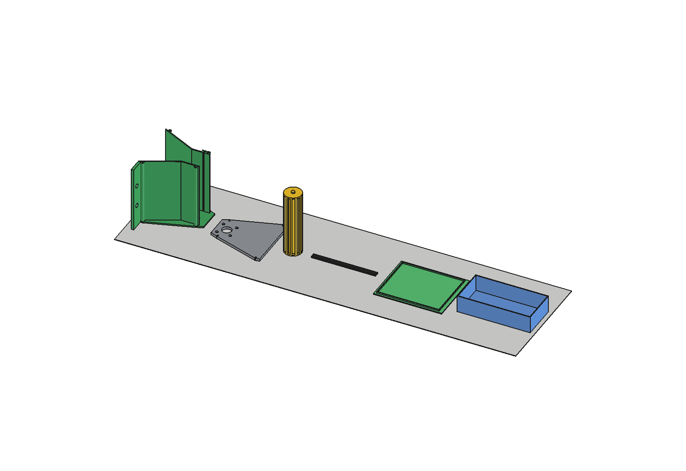
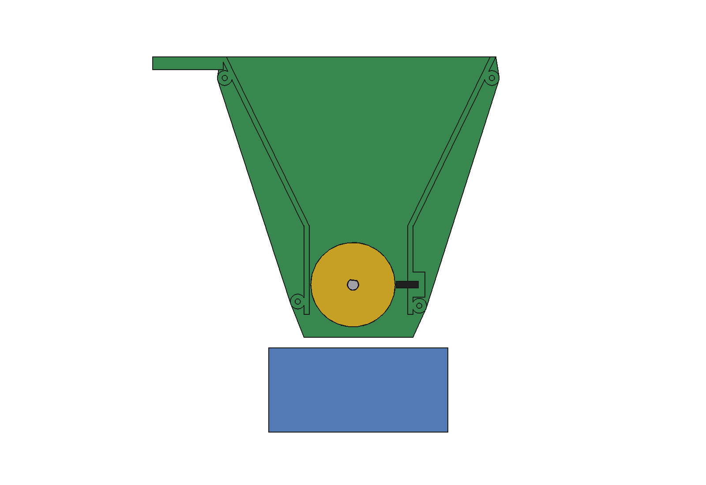
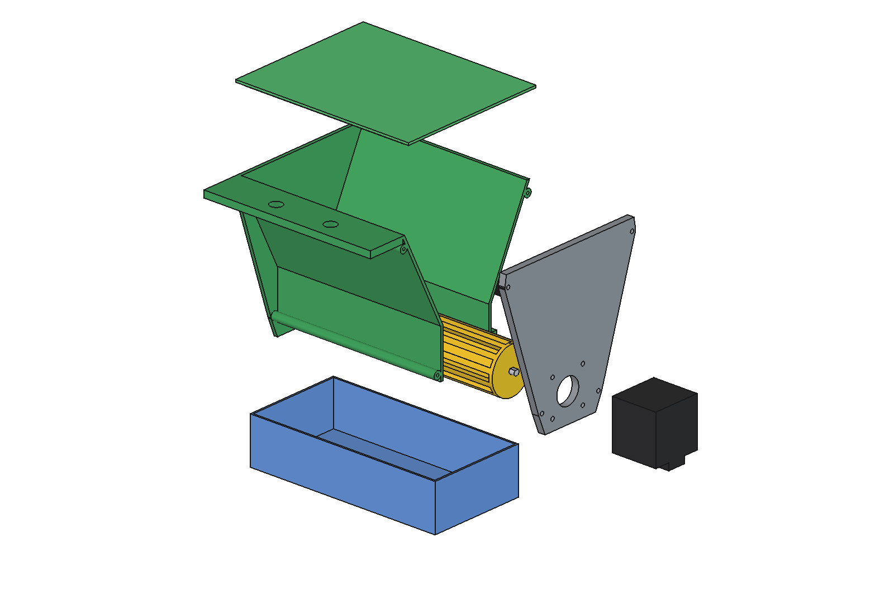

# Overseeder, mini drop seeder for 3D printing

A 150 mm wide, printable version of the metering of the [drop seeder](../../README.md): a hopper (bakje) with an
exchangeable fluted or cam roller in the throat, a rigid PETG cut-off rim (no brush), a NEMA 17 stepper and a
catch tray. Use it to:
- measure the **g per revolution** of a roller shape with your own seed before the 1 m roller is made (roller A has
  the same flute 6 × 5 mm as the big roller, so the calibration factor carries over);
- compare **five cam rollers** (D to H, coarse to very fine) with the fluted rollers A to C;
- test **on/off** of the seed curtain (stop without trickling, start delay) and the camera control on one row;
- seed small patches by hand or bolted to the robot (2 × M10 at 50 mm, the beam hole grid).


| | |
| --- | --- |
| Working width | 150 mm (inside of the hopper; roller 149 mm, flutes or cams over 143 mm) |
| Hopper | 1.13 l = about 400 g lawn seed (0.35 kg/l), walls 26° from vertical |
| Roller | Ø40 × 149, 8 variants A to H (table below); default A: 12 flutes 6 × 5, 40.6 ml = 14.2 g per revolution |
| Cut-off rim | PETG strip 3 mm thick, tip 0.5 mm from the roller, no contact |
| Speed | roller A: 35 g/m² at 0.5 m/s = 11 rpm = 592 microsteps/s (1/16) |
| Drive | NEMA 17 (42 × 40) directly on the roller; torque need 0.032 Nm peak, motor 0.25 Nm |
| Catch test | roller A: 10 revolutions = about 142 g = 406 ml, tray 524 ml |
| Print | 6 parts plus 7 roller variants (95 … 122 g each), base set about 353 g filament (≈ € 8), every part without support on a Bambu Lab A1 (256 × 256 × 256) |

## Parts and printing

| Part | STL | Material | Orientation | Size on the bed (mm) |
| --- | --- | --- | --- | --- |
| Hopper body | `stl/ovm_body.stl` | PETG | standing on the left end wall | 133 × 164 × 153 |
| Motor plate | `stl/ovm_motor_plate.stl` | PETG | flat, motor side down | 133 × 134 × 6 |
| Roller A (default) | `stl/ovm_roller.stl` | PETG | standing, motor end (D socket) down | 40 × 40 × 152 |
| Rollers B to H (variants) | `stl/ovm_roller_B.stl` … `_H` | PETG | standing, motor end (D socket) down | 40 × 40 × 152 |
| Cut-off rim | `stl/ovm_rim.stl` | PETG | flat | 150 × 10 × 3 |
| Lid | `stl/ovm_lid.stl` | PETG | upside down | 159 × 130 × 5 |
| Catch tray | `stl/ovm_tray.stl` | PETG | as it stands | 170 × 85 × 40 |

The STL files are already in the print orientation. Settings (Bambu Studio, A1): 0.4 mm nozzle, 0.2 mm layers,
6 walls (2.4 mm walls are then solid and seed-tight), 20 % infill, Textured PEI Plate, PETG for every part.



**Bought parts**: NEMA 17 stepper 42 × 40 (Ø5 D shaft, 24 mm) with a TMC2209 or A4988 driver and an Arduino/ESP32;
4 × M3 × 10 button head (ISO 7380) for the motor; 4 × M3 × 16 self-tapping (or M3 in the 2.5 mm pilot holes) for
the motor plate; for mounting 2 × M10.

## Roller variants

Eight exchangeable rollers for the test plan in [../../research/](../../research/README.md) §4 and
[../../research/cam_roller_shape_and_sealing.md](../../research/cam_roller_shape_and_sealing.md). All have the same outside
(Ø40 × 149), journal and D socket, and the flutes or cams stop 3 mm before each end. Swap the roller, run the catch
test, compare. Figures at 35 g/m² and 0.5 m/s (`python ovm_calc.py`):

| Variant | Shape | Volume per rev | Fill (est.) | g per rev | rpm | Filament |
| --- | --- | --- | --- | --- | --- | --- |
| A (default) | 12 straight rectangular flutes 6 × 5 | 50.7 cm³ | 0.8 | 14.2 | 11 | 95 g |
| B | 14 helical flutes, 10° lead, semicircular bottom R 3 | 27.8 cm³ | 0.8 | 7.8 | 20 | 111 g |
| C | 14 helical flutes, 10° lead, semicircular bottom R 2 | 12.5 cm³ | 0.8 | 3.5 | 45 | 122 g |
| D | cam roller, coarse: cams 6.5 × 9 × 5, 12 rings of 6, core Ø30 | 48.1 cm³ | 0.5 | 8.4 | 19 | 97 g |
| E | cam roller: cams 6 × 7 × 4, 14 rings of 8, core Ø32 | 38.8 cm³ | 0.6 | 8.1 | 19 | 104 g |
| F | cam roller: cams 5 × 6 × 3, 17 rings of 10, core Ø34 | 29.5 cm³ | 0.6 | 6.2 | 25 | 110 g |
| G | cam roller, fine: cams 4 × 5 × 2.5, 21 rings of 12, core Ø35 | 25.2 cm³ | 0.6 | 5.3 | 30 | 113 g |
| H | cam roller, very fine: cams 4 × 4 × 1.5, 25 rings of 16, core Ø37 | 14.4 cm³ | 0.6 | 3.0 | 52 | 121 g |

Cam sizes are along the axis × around × radial height.


- **Cam rollers D to H** follow the ring rollers in [../../inspiration/](../../inspiration/) (Zocon, APV): rectangular
  cams in rings, every second ring turned half a pitch around (brick pattern), from few tall cams (D, for chaffy
  seed and mixtures) to many low cams (H, for clover and small seed). The cam tips make Ø40, so the rim gap stays
  0.5 mm for every roller.
- **Volume per revolution** comes from the real cross-section: for A, the rectangle under the roller arc
  (29.6 mm², not 6 × 5); for B and C, the part of the R 3 / R 2 circle inside the roller, divided by cos 10° for the
  axial section; for D to H, the free annulus between the core and Ø40, minus the cams and the 45° rim step.
  `build_ovm.roller_variants()` measures the same on the solids: within 0.1 %.
- **B, F and G** run inside the 20 … 40 rpm range where the flow is even at the grass rate. **C and H** are for small
  seed at low rates; at the grass rate they would need 45 … 52 rpm. The fills of the cam rollers (0.5 … 0.6) are a
  guess, because cams drag seed rather than carry it in a closed pocket: the catch test measures it.
- Printing: the helical flutes lean 10° from vertical when the roller stands, and the top end of each flute bridges
  6 mm (B) or 4 mm (C), like A. On D to H the underside of every cam and of the top rim is chamfered at 45°. No
  support is needed for any variant.
- Variant parameters: `ROLLERS` in `ovm_params.py`. Use `ovm_parts.roller("F")` to build one, and
  `build_ovm.check_variants()` to run the interference check with each roller in turn.

## Cut-off rim

The front gap between the roller and the housing (6 mm) is closed at the height of the axis by a flat PETG strip,
3 mm thick, in a slot in the front wall. Its square tip stands **0.5 mm** from the roller (`rim_gap`). It strips
off the seed that lies on the roller, and the flutes or cam cells carry their seed down past it. The rim never
touches the roller: no brush, no lip pressure, no wear. If seed is crushed (gap too small) or runs through (gap too
large), change `rim_gap` and print a new rim (3 g).



## Assembly

1. Push the rim into the slot in the front housing wall from the open (right) end.
2. Slide the roller in from the right, journal first, into the hole in the left end wall.
3. Screw the motor to the motor plate (button heads in the counterbores on the inside).
4. Put the plate on the body with the motor shaft in the D socket of the roller, 4 screws into the columns.
5. Lid on, tray under it. Turn the motor so the **top of the roller moves forward** (towards the rim side): the
   flutes or cams carry seed down past the rim and empty at the bottom.



## Calibration (catch test)

1. Fill the hopper, run a few revolutions until seed falls, empty the tray.
2. Run 10 revolutions (32 000 microsteps at 1/16), weigh the tray: g per revolution = mass / 10. Calculated: 14.2 g
   (A; B to H in the table above).
3. Factor = measured / calculated. The same factor applies to the 1 m roller (`ovd_params.roller_fill`, `seed_density`).
4. Roller speed for a rate: rpm = rate (g/m²) × speed (m/s) × 0.15 m / (g per revolution) × 60.

## Files

| File | Contents |
| --- | --- |
| `ovm_params.py` | all dimensions, roller variants (`ROLLERS`), rim gap, print settings, stepper, seed |
| `ovm_parts.py` | one function per part (local frame, origin = roller axis); `roller(variant)` builds A to H |
| `build_ovm.py` | model tree, `COLOR`, checks (also per roller variant), filament per part, STL export in print orientation, images |
| `ovm_calc.py` | hopper, flute and cam cross-section and g per revolution per roller variant, rpm and microsteps, torque, catch test, comparison with the 1 m roller |
| `run_in_freecad.py` | macro: reload, build, print the key figures and the checks |
| `Overseeder_Mini_Print.FCStd`, `.step` | the model (generated) |
| `stl/` | the printable parts (generated by `build_ovm.export_stl()`) |
| `RATIONALE.md` | why |
| `previews/` | images |
| [`tt_motor/`](tt_motor/README.md) | a small test version (80 mm wide, 120 mm high, held by two M8 × 100 bolts) with a TT gear motor (1:48) instead of the NEMA 17: own motor plate and cam rollers with a double-D socket, complete STL set |

## Use

In FreeCAD 1.1 (Python console, or through the MCP connection):

```python
exec(open(r"F:\veldrobot\mini doseerbak\CAD_design\stepper_motor\run_in_freecad.py", encoding="utf-8").read())
import build_ovm
build_ovm.check_interference()      # hits must be empty (the rim does not touch the roller)
build_ovm.check_variants()          # the same with each roller variant A to H: every hits list empty
build_ovm.check_fit()               # parts that do not fit the A1 bed: must be empty
build_ovm.mass_properties()         # filament per part
build_ovm.roller_variants()         # filament per roller variant, modelled flute volume vs ovm_calc
build_ovm.export_stl()              # also stl/ovm_roller_B.stl … _H
build_ovm.render_all()
```

Without FreeCAD:

```bash
python ovm_calc.py
```

Axes (local, the rig is not drawn on the robot): x = along the roller (+x = motor), y = forward (rim side), z = up,
origin = the roller axis.

Background to the roller variants and the test plan: [../../research/](../../research/README.md).

## Estimated, not measured

- Bulk density of the seed (0.35 kg/l) and the filling of the flutes (80 %) and cam cells (50 … 60 %): that is what
  the catch test measures.
- Rim gap 0.5 mm: from the literature range for small seed, not tested with ryegrass.
- Torque peak of a seed pinched at the rigid rim (0.03 Nm).
- Usable torque of the NEMA 17 (0.25 Nm) and the speed where the flutes stop filling (60 rpm).
- Filament mass: solid volume × 0.55 for 6 perimeters and 20 % infill.
