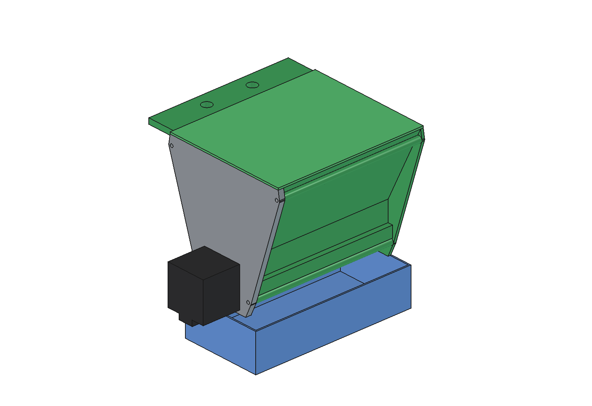
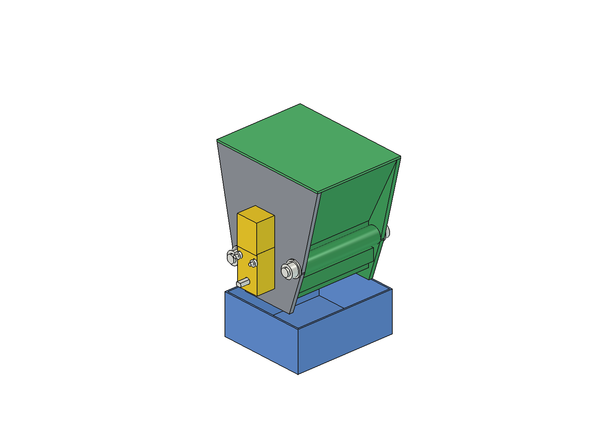
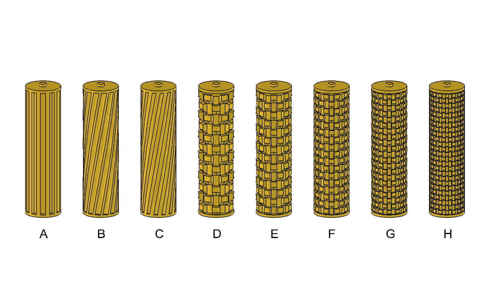
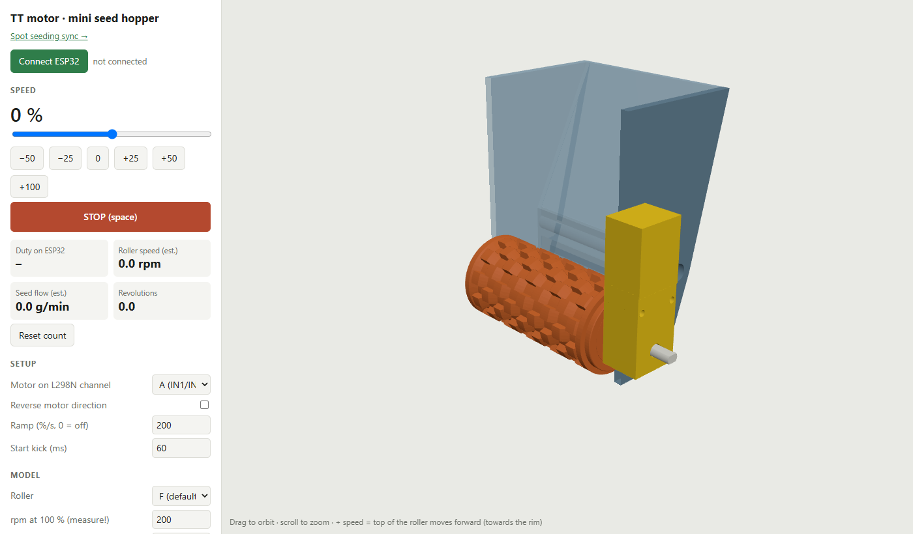
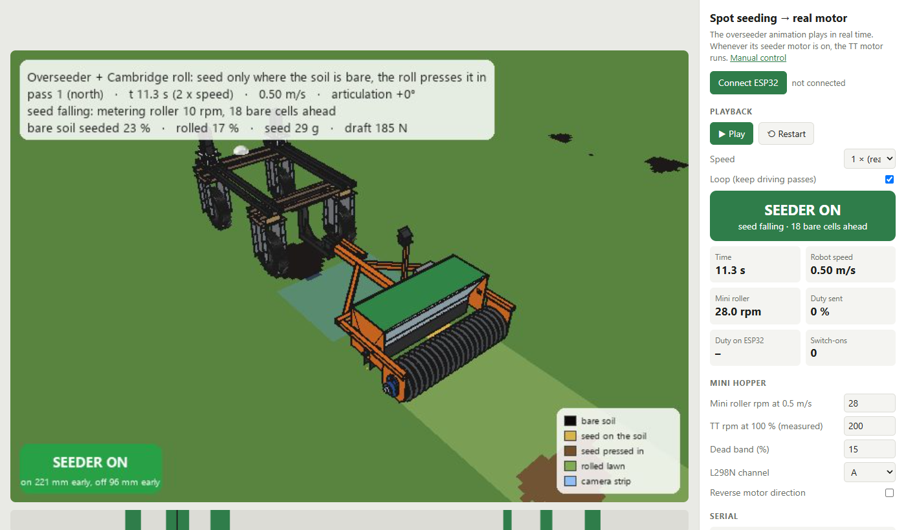

# Mini seed hopper for grass seed 🌱

**A 3D-printable test rig for the drop seeder of the field robot.** Fill it with grass seed, put a metering roller
in, and measure how evenly it doses: before the full-size seeder is built in steel.

  
  

<em>Left: base design (150 mm, NEMA 17). Right: small test version (80 mm, TT gear motor).</em>

## What it is

The field robot overseeds lawns: a camera looks for bare patches and the seeder only drops seed there. The heart of
the seeder is the **metering roller**: a roller with flutes or cams that carries a fixed volume of seed out of the
hopper on every revolution. This repo is a small, cheap version of that hopper, to find the best roller shape.

- 🖨️ **Printable**: every part in PETG on a Bambu Lab A1, no support (one roller needs a little).
- 🔩 **Designed as if in steel**: simple shapes, so the full-size seeder can be milled, sawn and welded.
- 🔁 **Exchangeable rollers**: fluted rollers and cam rollers, slide them in from the side.
- 🎛️ **Driven from the PC**: an ESP32 runs the motor at any speed, with a live 3D view of the roller.
- 🚜 **Synced with the field animation**: the real motor turns on when the robot in the animation reaches bare soil.

## Rollers

| Roller | Type | Why |
| --- | --- | --- |
| A | straight flutes | the classic; pulses at low speed |
| B, C | helical flutes | smoother flow, fewer pulses |
| D … H | cam rollers, from big cams to small | finer dosing at a higher, steadier rpm |
| I (TT version only) | roller F turned round | does the slope of the cams change the flow? |

Why these shapes: see [research/](research/README.md).

## Control from the PC

An ESP32 with an L298N drives the TT motor over USB. A small web page (Chrome or Edge) gives a speed slider and a
3D view of the real CAD parts, with the roller turning at the estimated speed.

**Spot seeding sync**: the second page plays the animation of the full-size overseeder on the robot, in real time.
Each time its seeder switches on above a bare patch, the TT motor on your desk turns too.

Quick start (details in [code/TT-motor/README.md](code/TT-motor/README.md)):

1. Wire the ESP32 to the L298N as in [connections.txt](code/TT-motor/connections.txt).
2. Flash [`tt_motor.ino`](code/TT-motor/firmware/tt_motor/tt_motor.ino) (board: ESP32 Dev Module).
3. Double-click [`code/TT-motor/app/start.bat`](code/TT-motor/app/start.bat), click **Connect ESP32**, move the slider.

The motor stops by itself 1.5 s after the page closes or the cable comes out.

## Two versions

| | [Base design](CAD_design/stepper_motor/README.md) | [Test version](CAD_design/TT-motor/README.md) |
| --- | --- | --- |
| Roller length in the hopper | 150 mm | 80 mm |
| Drive | NEMA 17 stepper | TT gear motor 1:48 (cheap, PWM) |
| Rollers | A … H (3 fluted, 5 cam) | D … I (cam) |
| Assembly | M3 screws, flange | two M8 × 100 bolts |
| Use | longer tests, accurate speed | quick, cheap tests |

The parts of the two sets do not fit each other: use the `ovm_` files together, or the `ovt_` files together.

## Printing on a Bambu Lab A1

All parts are already in print orientation. Do not rotate them.

| Setting | Value |
| --- | --- |
| Material | **PETG** for all parts (no ABS or ASA: the A1 is an open frame) |
| Nozzle / layer | 0.4 mm / 0.2 mm |
| Walls / infill | 6 walls (2.4 mm walls are solid and seed-tight) / 20 % |
| Plate | Textured PEI |
| Support | none, except tree support under the end face of roller I |

### Base design: 150 mm, NEMA 17 (`CAD_design/stepper_motor/stl/`)

| Part | STL | Size (mm) |
| --- | --- | --- |
| Hopper body | `ovm_body.stl` | 133 × 164 × 153 |
| Motor plate | `ovm_motor_plate.stl` | 133 × 134 × 6 |
| Roller A (default, fluted) | `ovm_roller.stl` | 40 × 40 × 152 |
| Rollers B, C (helical) and D … H (cam) | `ovm_roller_B.stl` … `_H` | 40 × 40 × 152 |
| Cut-off rim | `ovm_rim.stl` | 150 × 10 × 3 |
| Lid | `ovm_lid.stl` | 159 × 130 × 5 |
| Catch tray | `ovm_tray.stl` | 170 × 85 × 40 |

### Test version: 80 mm, TT gear motor (`CAD_design/TT-motor/stl/`)

| Part | STL | Size (mm) |
| --- | --- | --- |
| Hopper body (2 M8 bolt tubes) | `ovt_body.stl` | 120 × 117 × 84 |
| Motor plate (TT motor, roller bearing) | `ovt_motor_plate.stl` | 120 × 117 × 4 |
| Cam roller F (default) | `ovt_roller_F.stl` | 40 × 40 × 86 |
| Cam rollers D, E, G, H | `ovt_roller_D.stl`, `_E`, `_G`, `_H` | 40 × 40 × 86 |
| Cam roller I (tree support under its end face) | `ovt_roller_I.stl` | 40 × 40 × 86 |
| Cut-off rim | `ovt_rim.stl` | 80 × 10 × 3 |
| Lid | `ovt_lid.stl` | 88 × 117 × 5 |
| Catch tray | `ovt_tray.stl` | 100 × 85 × 40 |

Bought parts for the test version: TT gear motor 1:48, 2 × M8 × 100 with 4 washers and 2 nuts, 2 × M3 × 25 socket
head with 2 M3 nuts, an L298N module and an ESP32. Bill of materials and assembly:
[base](CAD_design/stepper_motor/README.md), [test version](CAD_design/TT-motor/README.md).

## Repository layout

| Folder | Contents |
| --- | --- |
| [CAD_design/stepper_motor/](CAD_design/stepper_motor/README.md) | base design: FreeCAD model, STEP, STL, scripts, previews |
| [CAD_design/TT-motor/](CAD_design/TT-motor/README.md) | test version with the TT gear motor |
| [code/TT-motor/](code/TT-motor/README.md) | ESP32 firmware and the PC control pages |
| [research/](research/README.md) | how to meter grass seed and herb mixtures, cam rollers and sealing |
| [inspiration/](inspiration/) | photos of commercial cam rollers and seed boxes |
| [docs/images/](docs/images/) | screenshots for this README |

The CAD is made in **FreeCAD 1.1** from Python scripts (`*_params.py` holds the dimensions). Change a dimension
there and rebuild; see the README of each CAD folder.

## Open points

- The cut-off rim is rigid PETG with a 0.5 mm gap (no brush). Test whether 0.5 mm crushes seed or lets seed run
  through, and change `rim_gap` if needed.
- The TT motor speed is estimated, not measured. Count the revolutions and set the values on the control page.

## License

[GNU AGPL v3](LICENSE).
